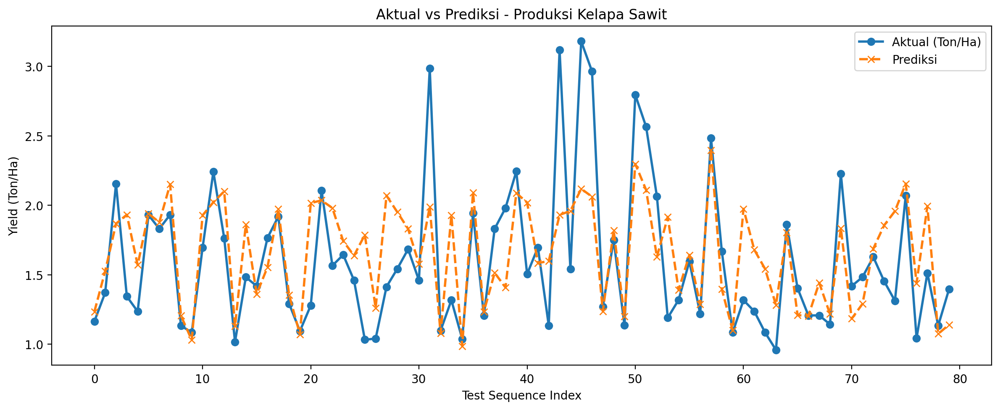
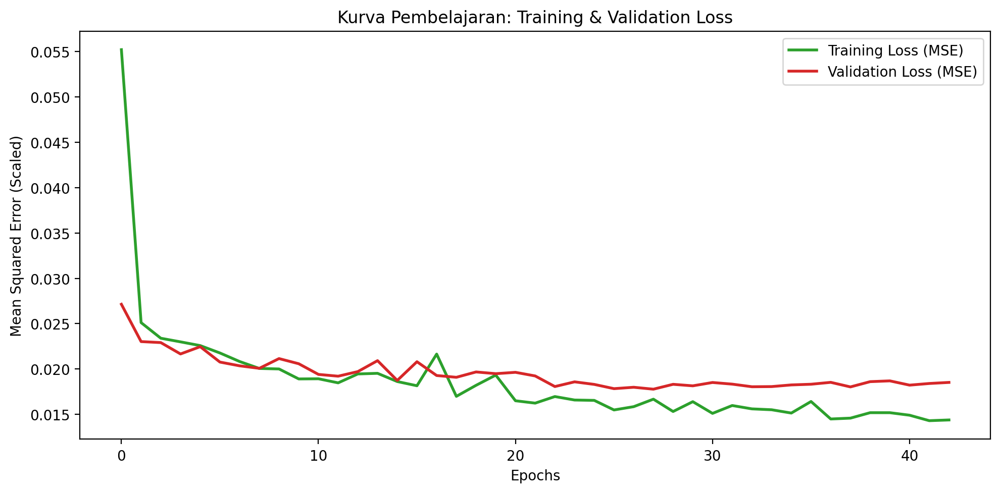
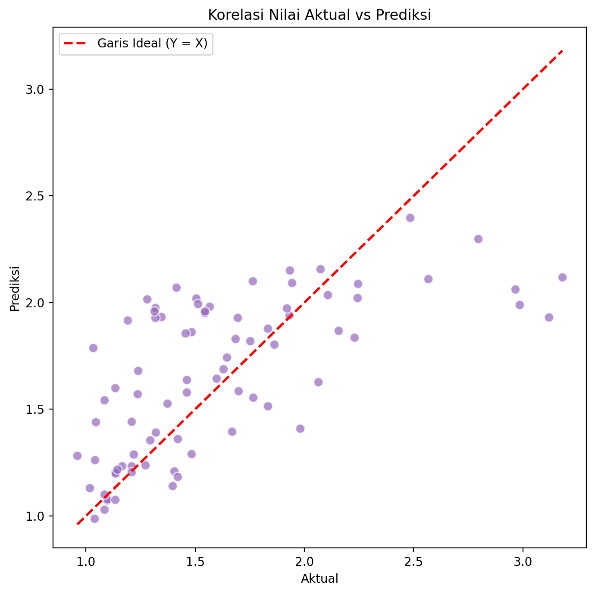

# Oil Palm Yield Prediction with LSTM

Predicts oil palm **yield (tons per hectare)** for a plantation block from its previous 12 months of operational and climate data, using a two-layer LSTM network. A Streamlit dashboard turns the model into a simple calculator that non-technical plantation staff can use.


The model combines plantation operating records (production, planted area, palm age) with rainfall data. Rainfall from **6, 12 and 24 months earlier** is added as lagged features, because the oil palm's flowering-to-harvest cycle means weather long ago still shapes today's harvest.

## Results

Measured on 80 time-series sequences the model never saw during training (`output/hasil_training.txt`):

| Metric | Value |
| --- | --- |
| MAE | 0.2922 t/ha |
| RMSE | 0.3958 t/ha |
| MAPE | 18.45% (target: below 20%) |

| Actual vs. predicted | Training history |
| --- | --- |
|  |  |



**Data at a glance:** 2,781 raw rows, 1,950 after removing duplicates, 63 blocks/divisions (`Entity_ID`), 14 input features, 529 sequences of 12 consecutive months. Split 70 / 15 / 15 (randomised): 370 training, 79 validation and 80 test sequences.

## How it works

- **Sequences per block.** Each sample is 12 consecutive months of one block, used to predict month 13. Blocks are kept separate so their histories never mix.
- **Leak-free scaling.** Scalers are fitted on the training set only, then applied to validation and test data.
- **Model.** LSTM (64 units) → Dropout 20% → LSTM (32 units) → Dropout 20% → Dense (1). Adam optimiser, learning rate 0.001, batch size 8; 32,673 parameters.
- **Features** (`src/config.py`): `Production_Kg`, `Area_Ha`, `Palm_Age`, `Rainfall_CH`, `RainyDays_HH`, rainfall and rainy-day lags at 6/12/24 months, cyclical month encoding (`Month_Sin`, `Month_Cos`) and past `Yield_Ton_Ha`. Full definitions are in [`dataset/Data_Dictionary.md`](dataset/Data_Dictionary.md).
- **Dashboard** (`app.py`). A Streamlit "smart calculator": enter a block profile and get an instant yield estimate.

## Project structure

```text
├── app.py                  # Streamlit dashboard (yield calculator)
├── train.py                # Training pipeline: preprocess → train → evaluate → export
├── src/
│   ├── config.py           # Paths, hyperparameters and feature list
│   ├── data_preprocessing.py
│   ├── model_builder.py    # Keras LSTM architecture
│   └── evaluate.py         # MAE / RMSE / MAPE and plots
├── notebooks/
│   ├── EDA_Analisis_Data.ipynb       # Exploratory analysis (correlation, trends)
│   └── Model_Interpretation.ipynb    # Error and residual analysis
├── dataset/
│   └── Data_Dictionary.md  # Variable definitions
├── output/                 # Metrics report and charts from the last training run
└── requirements.txt
```

## Getting started

Requires Python 3.8 or newer.

```bash
git clone https://github.com/rzkydell/Crop-Yield-Prediction-Using-LSTM.git
cd Crop-Yield-Prediction-Using-LSTM
pip install -r requirements.txt
```

> **Data and model weights are not included.** The plantation dataset (`dataset/Master_LSTM_Final_Large.csv`) is private, and the trained model and scalers (`models/*.keras`, `models/*.pkl`) are excluded by `.gitignore`. To run the project, place a CSV with the columns described in `dataset/Data_Dictionary.md` at that path.

**Train the model.** Adjust `EPOCHS`, `BATCH_SIZE` or `LEARNING_RATE` in `src/config.py` if needed, then:

```bash
python train.py
```

This preprocesses the data, trains the LSTM, writes the model and scalers to `models/`, and saves the metrics report and charts to `output/`.

**Open the dashboard** (needs the files in `models/` from a training run):

```bash
streamlit run app.py
```

The app opens at http://localhost:8501.

## Notes

This project was prepared as part of academic research. If you build on the lagged-rainfall approach, please cite this repository.

## Author

**Rizky Delianngi** · [Portfolio](https://rzkydell.vercel.app) · [GitHub](https://github.com/rzkydell)

<details>
<summary>Ringkasan (Bahasa Indonesia)</summary>

Prediksi hasil panen kelapa sawit (ton/ha) per blok dari data 12 bulan terakhir (produksi, luas, umur tanaman, curah hujan dan hari hujan dengan *lag* 6/12/24 bulan) menggunakan LSTM dua lapis, dilengkapi dashboard Streamlit sebagai kalkulator panen. Pada 80 sekuens data uji: MAE 0,2922 t/ha, RMSE 0,3958 t/ha, MAPE 18,45%. Dataset dan bobot model tidak disertakan di repositori.

</details>
